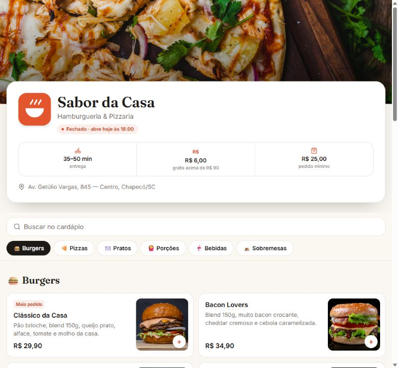

# Sabor da Casa — Cardápio digital

Cardápio digital para hamburgueria e pizzaria. O cliente monta o pedido no celular, escolhe tamanhos e adicionais, e envia tudo pronto para o WhatsApp da loja, sem precisar de app nem cadastro.

> Projeto demonstrativo: o restaurante é fictício.

**🔗 Demo:** [sabor-da-casa-pink.vercel.app](https://sabor-da-casa-pink.vercel.app)



## Funcionalidades

- **Cardápio por categorias**: barra fixa que acompanha a rolagem (scrollspy) e busca sem diferenciar acentos
- **Opções por produto**: grupos obrigatórios e opcionais, com mínimo e máximo de escolhas (tamanho da pizza, ponto da carne, adicionais, combo), validação e preço calculado na hora
- **Sacola**: itens iguais com as mesmas opções são agrupados, dá para alterar a quantidade e remover itens, e o carrinho fica salvo no navegador
- **Entrega ou retirada**: taxa de entrega, entrega grátis a partir de um valor (com barra de progresso) e pedido mínimo
- **Checkout**: endereço, forma de pagamento (Pix, cartão, dinheiro com troco) e dados lembrados para o próximo pedido
- **Pedido no WhatsApp**: a mensagem sai formatada com itens, opções, observações, totais, endereço e pagamento
- **Status da loja**: "Aberto até…" ou "Abre amanhã às…", calculado pelos turnos de cada dia
- Mobile first, *bottom sheets* acessíveis (`Esc`, foco, `aria-modal`) e suporte a `prefers-reduced-motion`

## Tecnologias

React 19 · TypeScript · Tailwind CSS 4 · Vite · lucide-react

## Rodando localmente

```bash
npm install
npm run dev
```

## Estrutura

```
src/
  data.ts                   # loja, horários, categorias, produtos e opções
  lib/cart.ts               # carrinho (useReducer), preços, horário e mensagem do pedido
  components/
    Sheet.tsx               # modal / bottom sheet base
    ProductSheet.tsx        # detalhes do produto e opções
    CartSheet.tsx           # sacola e checkout
  App.tsx                   # capa, busca, categorias e lista de produtos
```

Para usar em outro restaurante, basta editar o `src/data.ts`.

## Próximos passos

- Painel administrativo para editar produtos e pausar itens
- Pagamento Pix online com confirmação automática

---

Fotos: [Unsplash](https://unsplash.com) (licença Unsplash).
